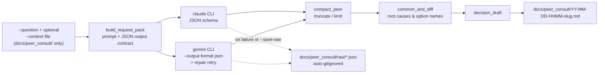

# Peer-Consult

English | [简体中文](./README_ZH.md)

[](https://github.com/AsaqeLee/peer-consult/actions/workflows/ci.yml)
[](LICENSE)


A Codex skill plus a small, dependency-free Python CLI that asks **Claude Code** and **Gemini CLI** for independent advice on a coding / architecture problem, then writes one Markdown summary with their common points, disagreements, and an auto-drafted decision that Codex (or you) can edit.

It is a developer workflow aid, not an automated decision engine.

## How it works



Decision draft rules (`src/peer_consult/engine.py`):

1. If both sides failed → no decision; fix inputs / CLI availability and rerun.
2. If one side failed → use the other side's recommendation.
3. If both recommend the same option (normalized name match) → pick it.
4. Otherwise prefer the recommendation with more listed tests (verifiability), then the one with fewer listed risks.
5. Still tied → "write tests to arbitrate the disagreement first".

## Safety boundaries

- Context is only read from files under `docs/peer_consult/` of the project root (path traversal is rejected).
- `--extra`, `--include-diff`, `--include-status` are intentionally disabled; the tool does not read `git diff/status` itself.
- The prompt tells peers they have no tool / file / network access and must answer from the given text only.
- Raw peer outputs are saved only on failure or with `--save-raw`, into `docs/peer_consult/raw/`, which is added to `docs/peer_consult/.gitignore`.

## Requirements

- Python 3.9+ (standard library only at runtime)
- `claude` and `gemini` CLIs on `PATH` (a missing CLI is reported as an error in the summary instead of crashing)

## Quick start

```bash
git clone https://github.com/AsaqeLee/peer-consult.git
cd peer-consult
pip install -e .

# inside the project you want advice on
mkdir -p docs/peer_consult
$EDITOR docs/peer_consult/request-login-bug.md   # redacted logs / snippets
peer-consult --question "Login returns 500 after token refresh" \
             --context-file docs/peer_consult/request-login-bug.md
# -> Wrote: docs/peer_consult/<timestamp>-login-returns-500-after-token.md
```

Without installing: `./bin/peer-consult ...`.

### CLI options

| Option | Meaning |
|---|---|
| `--question` | Required problem summary |
| `--project-root` / `--cd` | Project root (default: git top level, else cwd) |
| `--extra-file` / `--context-file` | Context file, must be under `docs/peer_consult/` |
| `--max-chars` | Truncate context (default 12000) |
| `--save-raw` | Also save raw peer outputs |
| `--strict` | Exit with code 2 if any peer call fails |

### Use as a Codex skill

The skill definition lives in `.codex/skills/peer-consult/SKILL.md` (with `assets/request_template.md`). See [README_ZH.md](README_ZH.md) for installing it to `~/.codex/skills/peer-consult`.

## Project layout

```text
.codex/skills/peer-consult/   Codex skill + request template
bin/peer-consult              runner without installation
src/peer_consult/
  cli.py        argument parsing
  main.py       orchestration, output / raw files
  providers.py  prompt pack, claude / gemini calls, diffing
  engine.py     compaction, decision draft, Markdown rendering
  paths.py      project root and docs/peer_consult boundary
  utils.py      truncation, slugs, formatting helpers
tests/          pytest / unittest tests
reference/      upstream skills (git submodule) and notes
```

## Tests

```bash
pip install -e . pytest
pytest -q tests
```

CI runs the tests on Python 3.9 and 3.12. Tests do not call real LLM CLIs.

## Status / limitations

Personal tooling. Synthesis heuristics are simple string matching and counting; they do not replace human judgment.

## License

MIT. See [LICENSE](LICENSE).
